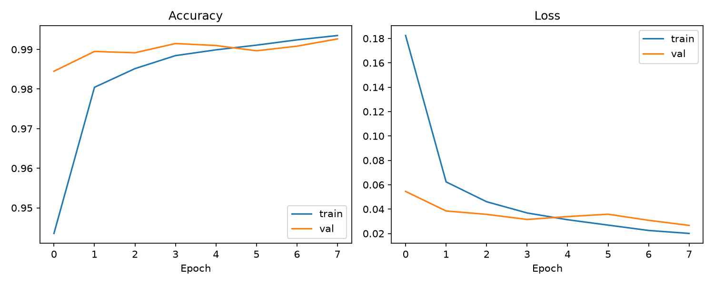
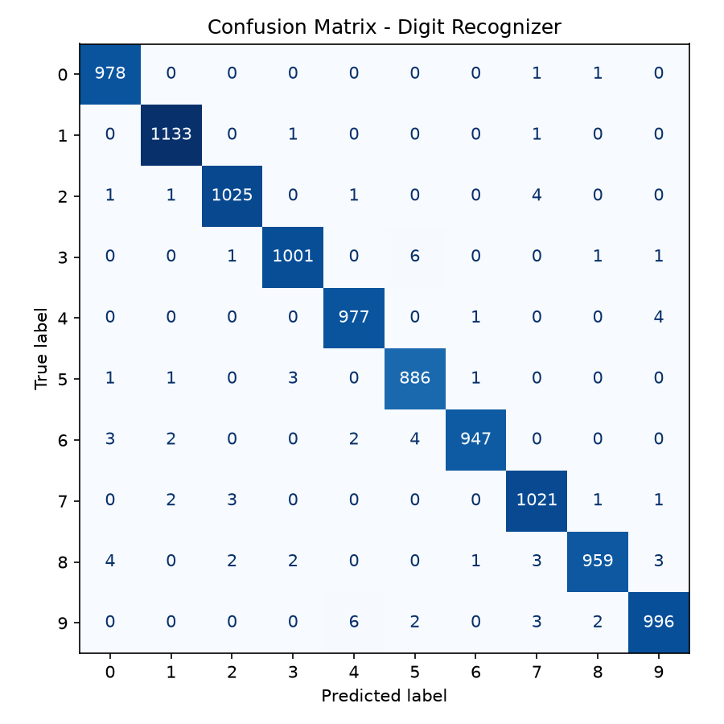
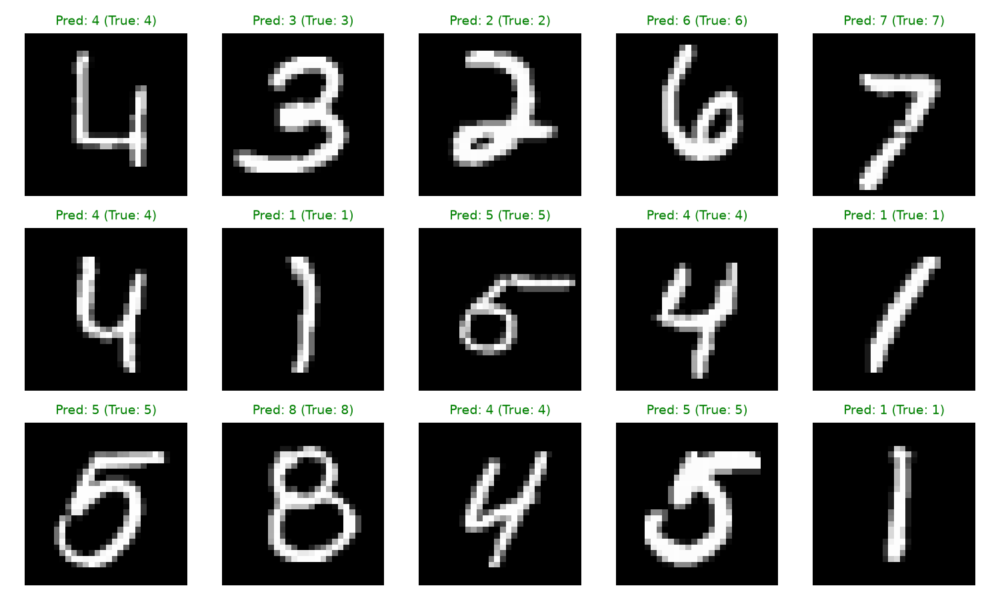

<div align="center">

# ✍️ Handwritten Digit Recognizer (CNN + MNIST)

### A Convolutional Neural Network that reads handwritten digits with 99%+ accuracy


</div>

---

## 📖 Overview

This project trains a **Convolutional Neural Network (CNN)** from scratch to recognize handwritten digits (0–9) using the classic **MNIST dataset** — 70,000 real, human-handwritten digit images. It was built as part of my **1-Month AI Internship at Codec Technologies**, applying Deep Learning and Computer Vision fundamentals to a complete, trainable, evaluable pipeline.

## ✨ Key Highlights

- 🧠 A from-scratch **CNN architecture** (Conv2D → MaxPooling → Conv2D → MaxPooling → Dense) — not a pretrained model
- 🎯 **99.23% test accuracy** on 10,000 unseen MNIST images
- 📉 Full training diagnostics — accuracy/loss curves across epochs, confusion matrix, per-class precision/recall
- 💾 Trained model saved in native Keras format for instant reuse
- 🖥️ Includes `predict.py` — load the saved model and get a live prediction with a full confidence breakdown, no retraining required
- 🔌 **Offline-safe by design**: automatically falls back to a smaller built-in digit dataset if run in a network-restricted environment, so the full pipeline always runs end-to-end

## 🗂️ Project Structure

```
digit-recognizer-cnn/
├── digit_recognizer.py           # Full pipeline: load → preprocess → train → evaluate
├── predict.py                    # Standalone inference on a random test digit
├── digit_recognizer_model.keras  # Saved trained model
├── confusion_matrix.png
├── training_curves.png
├── sample_predictions.png
├── requirements.txt
└── README.md
```

## 🧠 Model Architecture

```
Input (28x28x1 grayscale image)
   ↓
Conv2D(32 filters, 3x3, ReLU)  →  MaxPooling2D(2x2)
   ↓
Conv2D(64 filters, 3x3, ReLU)  →  MaxPooling2D(2x2)
   ↓
Flatten  →  Dropout(0.4)
   ↓
Dense(128, ReLU)
   ↓
Dense(10, Softmax)  →  digit prediction (0–9)
```

**~422K trainable parameters**, trained for 8 epochs with a 90/10 train/validation split.

## 🛠️ Tech Stack

| Category | Tools |
|---|---|
| Language | Python |
| Deep Learning | TensorFlow, Keras |
| Data / Metrics | NumPy, Scikit-learn |
| Visualization | Matplotlib |

## 🚀 Getting Started

```bash
# 1. Install dependencies
pip install -r requirements.txt

# 2. Train the model (auto-downloads full MNIST — 60,000 train / 10,000 test images)
python digit_recognizer.py

# 3. Try it on a random test digit
python predict.py
```

## 📊 Results

| Metric | Score |
|---|---|
| **Test Accuracy** | **99.23%** |
| Final Training Accuracy | 99.31% |
| Final Validation Accuracy | 99.18% |

**Per-digit performance (test set, 10,000 images):**

| Digit | Precision | Recall | F1-score |
|---|---|---|---|
| 0 | 0.99 | 1.00 | 0.99 |
| 1 | 0.99 | 1.00 | 0.99 |
| 2 | 0.98 | 1.00 | 0.99 |
| 3 | 0.99 | 1.00 | 0.99 |
| 4 | 0.99 | 1.00 | 0.99 |
| 5 | 0.99 | 0.99 | 0.99 |
| 6 | 0.99 | 0.99 | 0.99 |
| 7 | 0.99 | 0.98 | 0.99 |
| 8 | 0.99 | 0.99 | 0.99 |
| 9 | 1.00 | 0.97 | 0.98 |

### Training Curves


### Confusion Matrix


### Sample Predictions


## 🧠 What I Learned

- Learned how Conv2D and MaxPooling layers identify image features such as edges, curves, and loops from pixel data.
- Understood how Dropout helps reduce overfitting and improves the model's ability to generalize to unseen images.
- How to read training/validation curves to spot overfitting early
- How to interpret a multi-class confusion matrix to find which digits get confused with each other (here, 9 vs. 7/4 was the main confusion)

## 📈 Future Improvements

- [ ] Add data augmentation (rotation, shift, zoom) to improve robustness to messy handwriting
- [ ] Build an interactive drawing-canvas web app to test the model on live, freehand input
- [ ] Try a deeper architecture (additional Conv blocks or a ResNet-style skip connection) to push past 99.5%
- [ ] Export the model to TensorFlow Lite for mobile/edge deployment

## 👤 Author

**Baire Gowda**
AI Intern @ Codec Technologies

---
<div align="center">
⭐ If you found this project useful, consider giving it a star!
</div>
